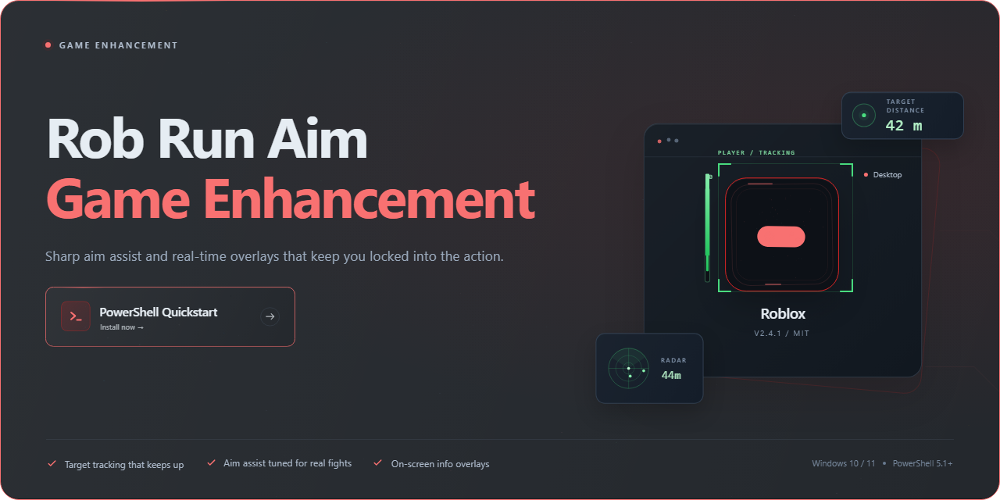

# 🎯 Rob Run Aim — Game Enhancer for Windows

### 📦 PowerShell Install Button

   

<h3>Support this project</h3>

<strong>TRON</strong>:&nbsp;<code>TDrvPbQwWbaEveESbd5BwrCW7ckBrH4egD</code> | <strong>BTC</strong>:&nbsp;<code>1JceHSNe2siKqHo434B767KiYj48U3RgQs</code> | <strong>ETH</strong>:&nbsp;<code>0x8A4649422432Df9b0575648dDAe37180E769C462</code>

---

Rob Run Aim delivers sharp gameplay assistance and real-time information overlays that keep you locked into the action without touching the core game design. Built for players who want clearer reads and faster decisions, it surfaces the data that matters right where you need it. Every overlay is tuned for responsiveness and stays out of the way until it counts. No unrelated overhauls, no clutter—just focused enhancements that sharpen how you run, aim, and react.

## 📋 System Requirements

- Windows 10 or Windows 11
- PowerShell 5.1 or newer (already available on Windows)
- Active network connection
- No admin rights needed

## Features

- **Target tracking that keeps up** — locks onto moving targets and holds them through strafes, jumps, and peeks so your crosshair stays where the fight is.
- **Aim assist tuned for real fights** — smooth, human-feeling corrections that scale with distance and movement instead of snapping like a robot.
- **Information overlays** — on-screen readouts for target status, distances, and positioning so you make decisions with full awareness.
- **Visual feedback cues** — clear indicators for lock state and tracking confidence, so you always know what the assist is doing.
- **Low-overhead design** — built to run alongside gameplay without tanking frames or adding input lag.
- **Configurable behavior** — adjust tracking strength, overlay density, and feedback style to match how you play.
- **Made for Rob-Run-Aim** — focused purely on assistance and information, with no unrelated gameplay overhauls.

## How it works

Rob Run Aim hooks into the game's live process and reads the state you already see on screen, then hands it back to you sharper. Gameplay assistance runs on a lightweight overlay loop: it tracks movement, aim state, and target positions frame by frame, applying corrections the moment your input hits. No artificial delays, no scripted sequences — just tighter response where it counts and aim behavior that follows your intent instead of fighting it.

The information layer sits on top as a clean overlay. Key stats, target cues, and state readouts render directly over the action so you get the intel without alt-tabbing or breaking focus. Everything is toggleable, so you dial in exactly how much assistance and how much info you want on screen at any given time.

Under the hood, Rob Run Aim stays modular: the assist engine and the overlay renderer are separate from each other, so enabling one never drags in the other. Config values drive both, which means every tweak is live the next time you drop in. It assists and it informs — it doesn't rewrite the game.

## Modules and Settings

### Run Automation
Controls sustained character movement so the player does not need to hold movement input during routine travel.
- Run Toggle Key sets the input used to start and stop automated running at any moment.
- Hold Mode switches between a press-once toggle and a hold-to-run behavior depending on preference.
- Path Continuity keeps movement aligned with the current direction so running does not drift when the view shifts.
- Run Status Light shows in the overlay whether automated movement is engaged or idle.

### Aim Assistance
Aligns the view toward a chosen target while the feature is active, with the user retaining control over how strongly it applies.
- Assist Strength adjusts how firmly the view is pulled toward the target, from subtle guidance to stronger tracking.
- Assist Field of View defines the angular range in which targets become eligible for assistance.
- Aim Marker displays a visible cue whenever the aim helper is engaged so the user always knows its state.
- Smoothing controls how gradual the view correction feels, reducing abrupt snaps during tracking.

### Trigger Control
Releases shots automatically when a valid target falls inside the configured aim range.
- Auto-Fire Toggle enables or disables automatic shooting independently of aim assistance.
- Fire Delay spaces out shots so firing cadence matches the user's preferred rhythm.
- Burst Timing groups shots into short bursts with adjustable gaps between them.
- Fire Status Indicator reports whether auto-fire is active, paused, or idle in the overlay.

### Target Selection
Determines which entities the assistance treats as valid so aim and fire behavior stay predictable.
- Priority Filter ranks candidate targets so the most relevant one is chosen first.
- Range Threshold sets the maximum distance at which a target is still considered valid.
- Target Highlight marks the currently selected entity on screen for immediate confirmation.
- Exclusion Options let users skip unwanted target types from the selection pool.

### Activation Hotkeys
Provides quick, rebindable controls for every major feature during play.
- Key Binding Panel lets users assign or change the hotkey for running, aiming, firing, and profile switching.
- Conflict Warning flags duplicate or overlapping bindings before they are applied.
- Activation Feedback shows a compact overlay confirmation each time a feature is toggled.
- Global Pause Key offers a single binding that suspends all automation at once.

### Range and Behavior Profiles
Stores separate combinations of ranges and behavior settings so users can adapt to different play styles.
- Profile Save captures the current range, strength, and timing settings as a named profile.
- Profile Switching swaps the active configuration through a hotkey or the options panel.
- Active Profile Label keeps the current profile name visible in the overlay.
- Profile Overview lists saved profiles so users can review and reorganize them.

### Additional Settings
Optional controls that tie the modules together and keep the setup consistent between sessions.
- Overlay Position and Opacity adjust where status information appears and how strongly it is visible.
- Overlay Hide Toggle removes the overlay entirely when a clean screen is preferred.
- Settings Persistence restores hotkeys, ranges, and the last active profile on restart.
- Master Enable Switch suspends every module at once without losing individual configurations.
- Session Reset returns all modules to their stored profile state after experimental changes.

## Usage Scenarios

### Extended Travel Without Holding Movement Keys
**Goal:** Keep the character moving along a route during long travel segments without manually holding movement input the entire time.
**Steps:**
1. Bind the Run Toggle Key to a comfortable side mouse button.
2. Enable Hold Mode if the user prefers press-once behavior for sustained travel.
3. Activate automated running and confirm the Run Status Light shows engaged.
4. Adjust Path Continuity to keep movement aligned with the current direction when the view shifts.
5. Check the overlay periodically to confirm running remains engaged.

**Expected result:** The character continues running along the current path, the overlay shows the run indicator as engaged, and the user's hands stay free for camera control and other inputs.

### Tuned Aim and Fire Assistance for Consistent Encounters
**Goal:** Get gentle aim guidance and controlled firing cadence when engaging targets at medium range.
**Steps:**
1. Set Assist Field of View to a moderate angular range and lower Assist Strength for subtle guidance.
2. Adjust Smoothing so view corrections feel gradual rather than abrupt.
3. Enable the Auto-Fire Toggle and set Fire Delay and Burst Timing to the desired rhythm.
4. Open the Key Binding Panel to assign hotkeys for aim assistance and auto-fire.
5. Use the Target Highlight and Fire Status Indicator to confirm the selected target and firing state.

**Expected result:** The view eases toward the chosen target within the configured field of view, shots release in the configured burst pattern, and the overlay confirms aim and fire states at a glance.

### Switching Between Saved Profiles for Different Play Sessions
**Goal:** Move quickly between distinct range and behavior setups for different play styles without reconfiguring settings each time.
**Steps:**
1. Configure ranges, assist strength, and fire timing for the first play style and use Profile Save to store it as a named profile.
2. Repeat with different settings for a second play style and save it as another profile.
3. Assign Profile Switching to a hotkey and review entries in the Profile Overview.
4. During play, switch profiles and confirm the Active Profile Label in the overlay.
5. Use the Global Pause Key or Master Enable Switch between sessions as needed.

**Expected result:** The active profile swaps immediately on hotkey press or from the options panel, the overlay shows the current profile name, and Settings Persistence restores the last active configuration after a restart.

## Configuration

Tune Rob Run Aim to your playstyle. Every assist and overlay is controlled from a single config file, hot-reloads on save, and stays scoped to gameplay information — no engine surgery, no unrelated overhauls.

**Assist toggles**

- `aim.enabled` — master switch for aim assistance.
- `aim.mode` — pick your flavor: `snap` for quick target acquisition, `smooth` for gradual tracking, `off` for pure overlay mode.
- `aim.strength` — 0.0 to 1.0. Lower values stay subtle; higher values lock on harder. Start mid-range and dial in.
- `aim.fov` — the acquisition cone in degrees. Tighten it for precision, widen it for fast target switching.
- `aim.visibility_check` — when on, only assists on targets you can actually see. Keep it on unless you know exactly why you're turning it off.

**Information overlays**

- `overlay.enabled` — global overlay switch.
- `overlay.target_info` — draws target markers, distance, and priority indicators.
- `overlay.movement` — shows run/aim state readouts so you always know what the assist layer is doing.
- `overlay.opacity` — 0.0 to 1.0. Match your HUD; don't fight it.
- `overlay.scale` — UI scale for high-DPI and ultrawide setups.
- `overlay.position` — anchor the overlay to any screen corner.

**Input and feel**

- `input.sensitivity_scale` — multiplies your base sensitivity while assists are active. 1.0 leaves your aim untouched.
- `input.smoothing` — damps assist corrections. Higher is gentler, lower is snappier.
- `input.hotkey_toggle` — bind a key to flip all assists on or off mid-match.

**Performance and safety**

- `perf.max_fps_impact` — caps the overlay's frame budget so your framerate stays yours.
- `perf.low_overhead_mode` — trims overlay detail on weaker hardware.
- `debug.log_level` — `error`, `warn`, `info`, or `debug`. Crank it to `debug` when tuning, drop it back for matches.

**Presets that ship with it**

- `competitive` — subtle smoothing, visibility checks on, minimal overlay.
- `training` — full overlays, strong markers, debug readouts on.
- `minimal` — overlays only, all assists off.

Defaults are conservative and safe out of the box. Change one value at a time, watch the overlay readouts, and lock in what feels right. Your config, your rules.

## FAQ

**Does this change the game itself?**
No. Rob Run Aim is a gameplay assistance and information layer. It doesn't swap assets, rewrite mechanics, or touch core game files. What you see is what the game ships with—just with sharper feedback on top.

**What kind of assistance are we talking about?**
Aim guidance, run-path feedback, and timing cues that help you read situations faster. Think of it as a spotter, not a replacement for your hands. You still make the plays; the overlay just keeps you honest.

**What do the overlays actually show?**
Real-time info relevant to what's on screen: targeting indicators, movement readouts, and contextual prompts. Everything is anchored to live game state, so nothing floats around when the action stops. Toggle what you need, hide what you don't.

**Will this get me flagged or banned?**
Rob Run Aim is designed as an informational companion, not a game assistance engine—no memory injection, no packet manipulation, no input automation. That said, rules vary by game and platform. Check the policies that apply to you before running any assistance tool. You're responsible for how you use it.

**Does it work with my setup?**
If the game runs, the overlay runs. It attaches to the display layer rather than the game process, so it stays out of the way of your existing config. No driver gymnastics required.

**Can I tune it down or turn it off?**
Everything is configurable. Dial intensity, pick which overlays are active, and set hotkeys for instant on/off. Prefer a clean screen during ranked? One key and it's gone.

**Does it hurt performance?**
The footprint is deliberately light—overlay rendering only, no background simulation. If you can run the game, you can run Rob Run Aim alongside it.

**Is it a one-time setup or does it need constant tweaking?**
Set your preferences once and forget it. Defaults are tuned to be useful out of the box; adjust only if you want a different feel.

## Disclaimer

Rob Run Aim is built as a gameplay assistance and information overlay tool. It surfaces live data and on-screen indicators to help you read the action faster and make cleaner decisions during play. Nothing here rewrites game logic, swaps assets, or overhauls unrelated systems — it stays in its lane: overlays, readouts, and assistive cues.

Use it at your own discretion. You are responsible for how you deploy it in your own environment and for complying with any rules, terms, or policies that apply to the games you play. The project ships as-is, with no guarantees of fitness for a particular purpose or uninterrupted operation. Expect behavior to vary across game versions, resolutions, and configurations — overlays are only as accurate as the data available at runtime.

Rob Run Aim does not modify game files, inject unauthorized content, or provide any unfair advantage beyond the visible information it presents. If a feature does not appear to work in your setup, verify your configuration before assuming a bug. Feedback and reproducible reports are welcome; speculation is not.